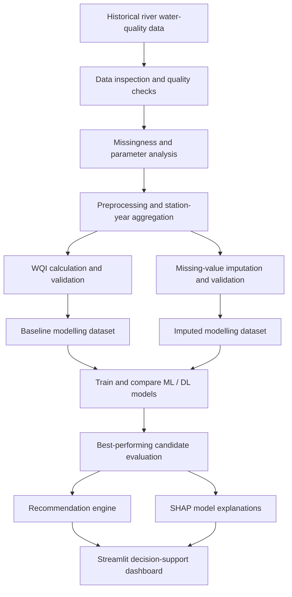
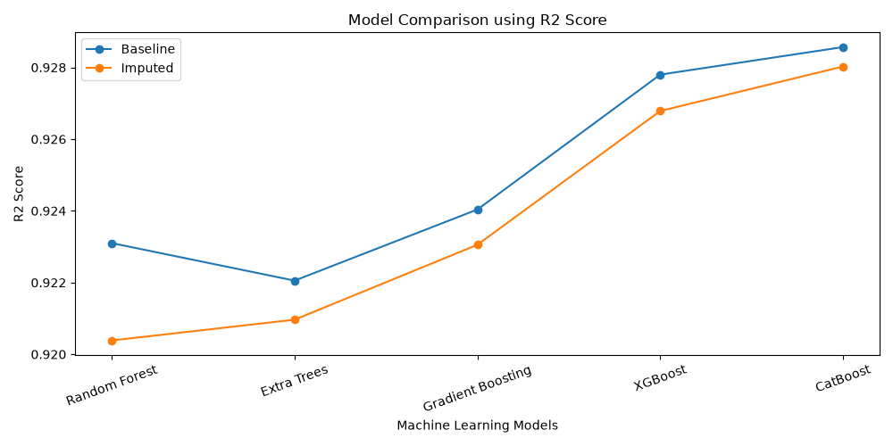
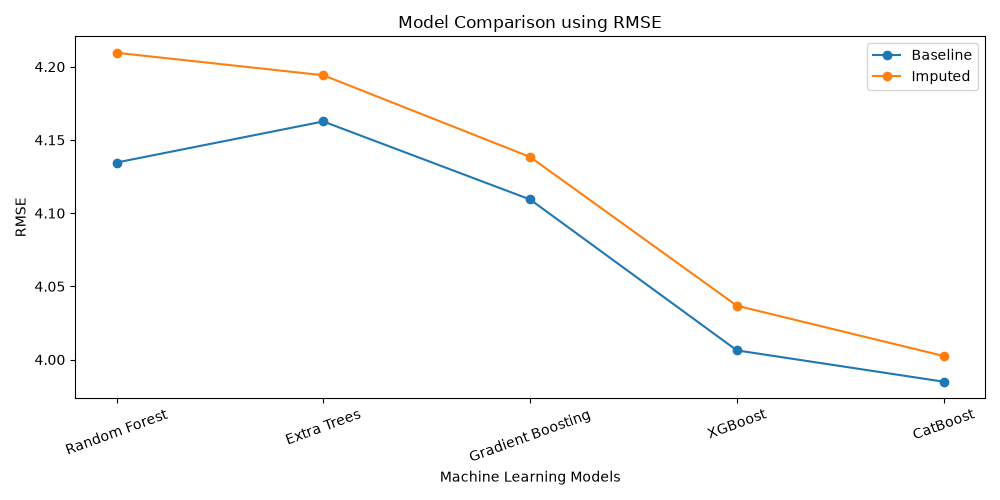
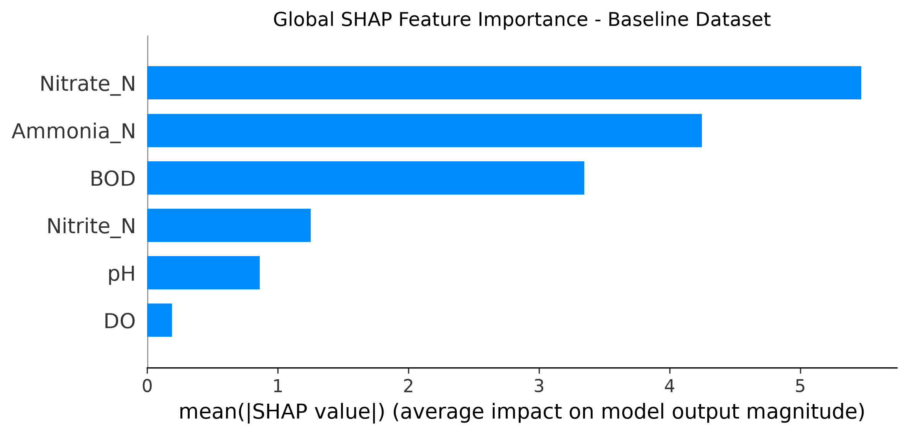
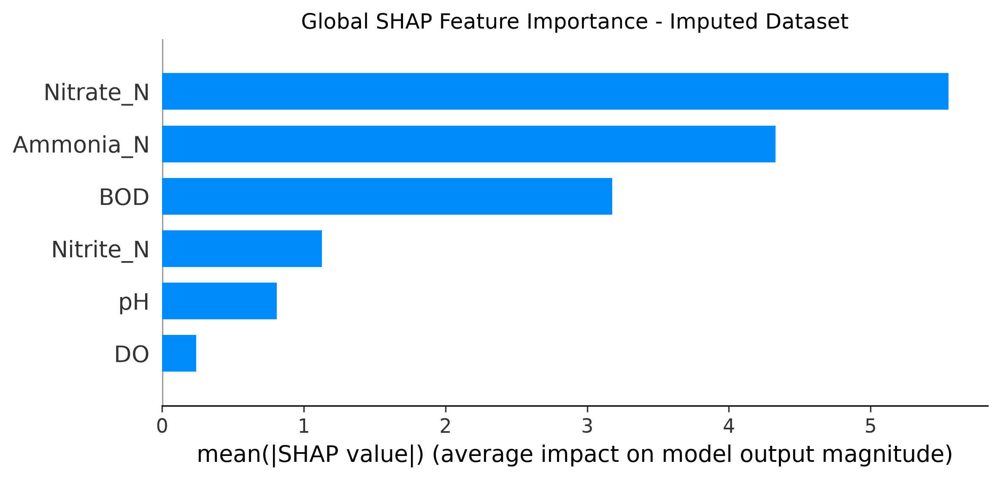

<div align="center">

# 💧 Water Quality Risk Assessment
### Explainable Machine Learning for Water Quality Prediction & Decision Support

**From historical river measurements to interpretable water-quality estimates and actionable monitoring guidance.**

<p>
  
  
  
  
</p>

**A data-science capstone project** combining data-quality assessment, missing-value handling, Water Quality Index (WQI) modelling, explainable AI, and a Streamlit decision-support dashboard.

</div>

---

## 🌊 The project in 30 seconds

Water-quality records can be incomplete, difficult to compare across stations and years, and hard to translate into practical follow-up actions. This project builds an end-to-end workflow that prepares historical water-quality observations, estimates the **Canadian Council of Ministers of the Environment Water Quality Index (CCME WQI)**, compares machine-learning approaches, explains predictions with **SHAP**, and turns detected parameter exceedances into monitoring recommendations.

| 🧹 Prepare | 🤖 Predict | 🔎 Explain | 🧭 Recommend |
|:--:|:--:|:--:|:--:|
| Inspect, clean and analyse missing data | Train and compare ML/DL models | Identify influential water-quality parameters | Surface possible pressures and follow-up actions |

> **Important:** This is a research and decision-support prototype. Predictions and rule-based recommendations are not a substitute for laboratory confirmation, local regulatory standards, or professional environmental assessment.

## ✨ What makes it interesting?

- **Data-quality first:** separate scripts inspect raw data, validate values, analyse missingness, and build station-year datasets.
- **Baseline vs. imputed comparison:** experiments compare modelling on the baseline data with modelling on an imputed dataset.
- **Multiple model families:** Random Forest, Extra Trees, Gradient Boosting, XGBoost, CatBoost, DNN and TabNet experiments.
- **Explainable AI:** SHAP global importance, summary/dependence plots, and local waterfall explanations help interpret model behaviour.
- **Decision support:** a recommendation engine checks selected parameter thresholds and provides suggested follow-up monitoring actions.
- **Visual exploration:** a Streamlit dashboard provides an interactive interface for water-quality assessment.

## 🧠 How the system works



## 📊 Results snapshot

The repository includes a saved benchmark comparing five tree-based regressors on baseline and imputed datasets. The table below is transcribed from `03_XGBoost/05_Machine_Learning/master_ml_benchmark_results.csv`; metrics are from the experiment outputs bundled with this project.

| Dataset | Model | MAE ↓ | RMSE ↓ | R² ↑ |
|---|---|---:|---:|---:|
| Baseline | Random Forest | 3.0245 | 4.1346 | 0.9231 |
| Baseline | Extra Trees | 3.0872 | 4.1626 | 0.9221 |
| Baseline | Gradient Boosting | 3.0791 | 4.1093 | 0.9240 |
| Baseline | XGBoost | 2.9187 | 4.0063 | 0.9278 |
| **Baseline** | **CatBoost** | **2.9632** | **3.9849** | **0.9286** |
| Imputed | Random Forest | 3.0870 | 4.2095 | 0.9204 |
| Imputed | Extra Trees | 3.1329 | 4.1942 | 0.9210 |
| Imputed | Gradient Boosting | 3.1068 | 4.1384 | 0.9231 |
| Imputed | XGBoost | 2.9579 | 4.0368 | 0.9268 |
| Imputed | CatBoost | 2.9799 | 4.0024 | 0.9280 |

**Reading the metrics:** lower MAE and RMSE indicate smaller prediction errors; higher R² indicates that the model explains more of the observed target variation. In this saved benchmark, baseline CatBoost has the highest R² (0.9286), while baseline XGBoost has the lowest MAE (2.9187). These values describe the bundled experiment, not guaranteed performance on new locations or future measurements.

### 📈 Visual results

The figures below are already included in the repository. Click any image to open it at full size.

<table>
  <tr>
    <td width="50%">
      <strong>Model comparison — R²</strong><br>
      <a href="03_XGBoost/05_Machine_Learning/master_model_comparison_r2.png"></a>
    </td>
    <td width="50%">
      <strong>Model comparison — RMSE</strong><br>
      <a href="03_XGBoost/05_Machine_Learning/master_model_comparison_rmse.png"></a>
    </td>
  </tr>
  <tr>
    <td width="50%">
      <strong>Global feature importance — baseline</strong><br>
      <a href="04_SHAP/outputs/shap_bar_baseline.png"></a>
    </td>
    <td width="50%">
      <strong>Global feature importance — imputed</strong><br>
      <a href="04_SHAP/outputs/shap_bar_imputed.png"></a>
    </td>
  </tr>
</table>

## 🔬 Inputs and modelling

The modelling scripts use these six water-quality parameters as features:

| Feature in code | What it represents |
|---|---|
| `BOD` | Biochemical Oxygen Demand |
| `DO` | Dissolved Oxygen |
| `Ammonia_N` | Ammonia nitrogen |
| `Nitrite_N` | Nitrite nitrogen |
| `Nitrate_N` | Nitrate nitrogen |
| `pH` | Acidity/alkalinity measure |

**Prediction target:** `CCME_WQI`, a numeric Water Quality Index. The project code also maps index values to qualitative categories (`Excellent`, `Good`, `Fair`, `Marginal`, `Poor`).

The repository contains raw and processed CSV files, imputation-validation outputs, model comparison tables, plots, recommendation outputs, research documents, a project report, and a presentation. Please check the dataset documentation and project report for the precise data provenance, filtering choices, WQI implementation, and experimental assumptions before reusing results.

## 🗂️ Repository guide

```text
Water_Quality_Risk_Assessment/
├── 01_Project_Proposal/       # Proposal, literature review and dataset materials
├── 02_Models/                 # Inspection, preprocessing, quality control and WQI
├── 03_XGBoost/
│   ├── 05_Machine_Learning/   # Tree-based models, comparisons and saved plots
│   └── 06_Deep_Learning/      # DNN / TabNet experiments and comparisons
├── 04_SHAP/                   # Global and local explainability analysis
├── 05_Recommendation_Engine/  # Parameter checks and recommendation outputs
├── 06_Dashboard/              # Streamlit dashboard application
├── 07_Research_Paper/          # Research-paper drafts and exports
├── 08_Project_Report/          # Capstone report
└── 09_Presentation/            # Project presentation
```

> Folder contents may evolve as experiments are refined. Some outputs are generated by scripts, and certain scripts expect input CSVs or model files at specific relative paths. Run scripts from the directory and with the inputs described in their code/report.

## 🚀 Getting started

### 1. Clone the repository

Replace `YOUR_GITHUB_USERNAME` with your GitHub username after you create the repository.

```bash
git clone https://github.com/YOUR_GITHUB_USERNAME/Water-Quality-Risk-Assessment.git
cd Water-Quality-Risk-Assessment
```

### 2. Create a virtual environment

**macOS / Linux**
```bash
python3 -m venv .venv
source .venv/bin/activate
python -m pip install --upgrade pip
```

**Windows PowerShell**
```powershell
py -m venv .venv
.venv\Scripts\Activate.ps1
python -m pip install --upgrade pip
```

### 3. Install dependencies

```bash
pip install -r requirements.txt
```

### 4. Launch the dashboard

From the repository root:

```bash
streamlit run 06_Dashboard/01_dashboard.py
```

The dashboard loads trained CatBoost model files from `05_Recommendation_Engine/`. If the `.cbm` files are not present in your checkout, run the recommendation-engine training workflow first (see `05_Recommendation_Engine/01_recommendation_engine.py`) and check its required input CSV paths. The dashboard and analysis scripts may require running from the repository root or adjusting relative paths depending on the script.

### 5. Run an experiment

Start with the data inspection and preprocessing scripts in `02_Models/`, then follow the numbered scripts in the relevant modelling folder. Review each script's input/output paths before running it: some scripts expect intermediate files created by earlier stages.

## 🧰 Technology stack

- **Language:** Python
- **Data handling:** pandas, NumPy
- **Machine learning:** scikit-learn, XGBoost, CatBoost
- **Deep learning:** PyTorch (used by the DNN/TabNet experiments, depending on the script)
- **Explainability:** SHAP
- **Visualisation:** Matplotlib
- **Interactive dashboard:** Streamlit

## 🛡️ Responsible use and limitations

- Model quality depends on data coverage, station/year selection, imputation choices, and the evaluation design.
- Imputed measurements are estimates; they should not be treated as directly observed values.
- Feature attribution describes how a model produced a prediction; it does **not** establish causation or prove a pollution source.
- Thresholds in the recommendation engine are project rules and may not match every jurisdiction, water body, or intended use.
- Always validate predictions against reliable measurements and applicable environmental standards before making operational decisions.

## 🧭 Future improvements

- Add a documented dataset card with licensing, source attribution, field definitions, and collection details.
- Add reproducible environment locking and a single configuration file for data/model paths.
- Add automated tests for WQI calculations, preprocessing, category boundaries, and recommendation rules.
- Use station- or time-aware validation to better assess generalisation beyond randomly held-out records.
- Package the dashboard with model artifacts or a reproducible model-training command.
- Add maps, temporal trends, uncertainty estimates, and monitoring-station filters.

## 👥 Project information

**Project:** Water Quality Risk Assessment  
**Type:** Capstone / academic research project  
**Focus:** Machine learning, explainable AI, water-quality assessment, decision support

If you use or adapt this work, please cite the project appropriately and verify dataset licensing and attribution requirements. Add team member names, faculty guide, institution, and contact links here before making the repository public if you want them displayed.

---

<div align="center">

**💧 Making water-quality modelling more interpretable and actionable.**

If this project is useful, consider giving the repository a ⭐

</div>
